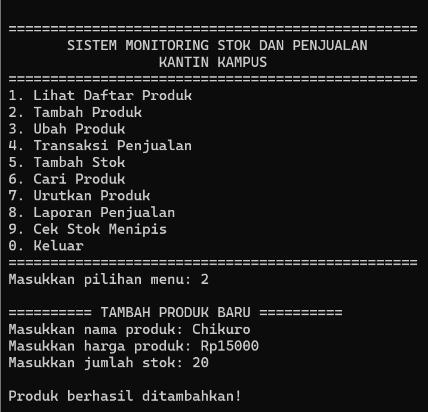
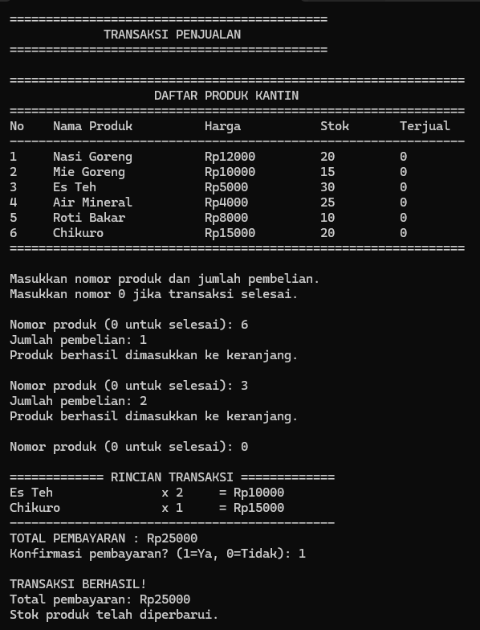
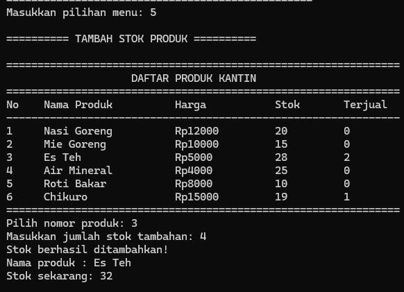
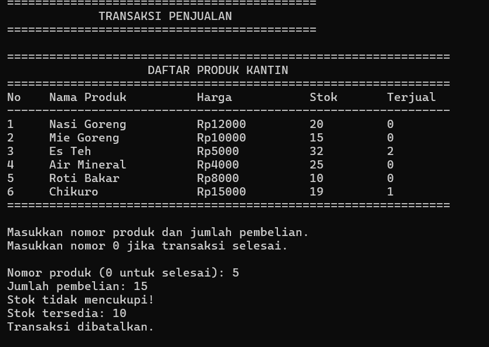
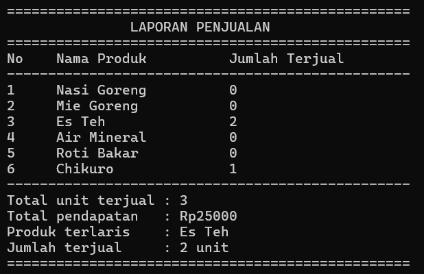
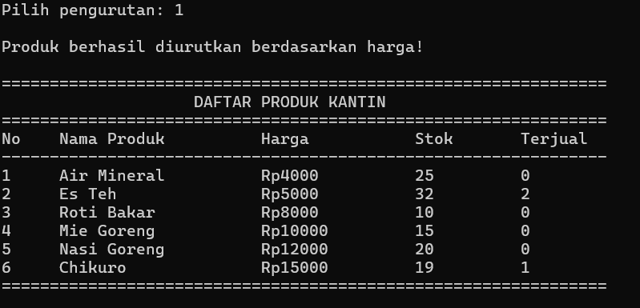
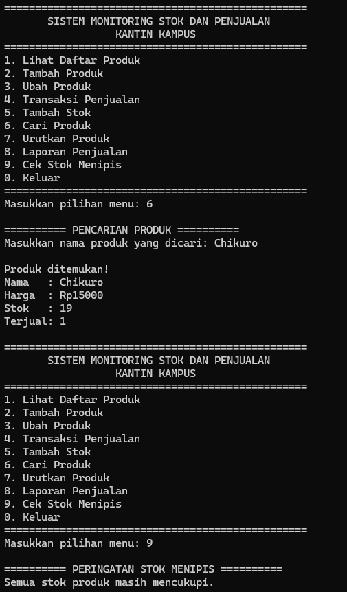

# SISTEM MONITORING STOK DAN PENJUALAN KANTIN KAMPUS
## IDENTITAS MAHASISWA

- **Nama:** SITI SOLIHAH
- **NIM:** C2583207029
- **Kelas:** PTI 3A 
- **Program Studi:** Pendidikan Teknologi Informasi
- **Universitas:** Universitas Muhammadiyah Tasikmalaya
- **Mata Kuliah:** Algoritma dan Pemrograman Lanjutan
- **Dosen Pengampu:** Taofik Muhammad, M.Kom

---

## 1. DESKRIPSI PROYEK

Sistem Monitoring Stok dan Penjualan Kantin Kampus merupakan aplikasi berbasis console yang dibuat menggunakan bahasa pemrograman C.
Program ini bertujuan untuk membantu pengelola kantin dalam mengelola data produk, memantau persediaan stok, melakukan transaksi penjualan beberapa produk, serta menampilkan laporan hasil penjualan.
Aplikasi ini dibuat untuk memenuhi Tugas Proyek Praktikum UTS mata kuliah Algoritma dan Pemrograman Lanjutan Tahun Akademik 2026/2027 Ganjil.

## 2. TUJUAN PROYEK

1. Mengelola data produk kantin.
2. Memantau ketersediaan stok barang.
3. Memproses transaksi beberapa produk.
4. Menghitung total pembayaran secara otomatis.
5. Menampilkan jumlah produk yang terjual.
6. Menampilkan laporan pendapatan dan produk terlaris.
7. Menerapkan konsep algoritma dan pemrograman bahasa C.

## 3. FITUR PROGRAM

| No | Nama Fitur | Keterangan |
|---|---|---|
| 1 | Lihat Daftar Produk | Menampilkan nama, harga, stok, dan jumlah terjual |
| 2 | Tambah Produk | Menambahkan produk baru |
| 3 | Ubah Produk | Mengubah harga dan stok produk |
| 4 | Transaksi Penjualan | Membeli beberapa produk dalam satu transaksi |
| 5 | Tambah Stok | Menambah persediaan produk |
| 6 | Cari Produk | Mencari produk berdasarkan nama |
| 7 | Urutkan Produk | Mengurutkan harga dan jumlah penjualan |
| 8 | Laporan Penjualan | Menampilkan total unit, pendapatan, dan produk terlaris |
| 9 | Cek Stok Menipis | Menampilkan produk dengan stok kurang dari 5 |
| 0 | Keluar | Mengakhiri program |

## 4. PENERAPAN ARRAY
Program menggunakan array sebagai struktur data utama.

### A. Array Karakter Dua Dimensi
Digunakan untuk menyimpan nama produk.
```c
char namaProduk[50][50];
```
### B. Array Satu Dimensi
Digunakan untuk menyimpan harga, stok, dan jumlah produk yang terjual.
```c
long long harga[50];
int stok[50];
int jumlahTerjual[50];
```
### C. Jumlah Produk
```c
int jumlahProduk = 5;
```
Program memiliki kapasitas maksimal 50 produk dan menyediakan 5 produk sebagai data awal.

## 5. ALGORITMA YANG DIGUNAKAN

- **Array:** Menyimpan data produk.
- **Percabangan:** Menggunakan if, else, dan switch-case.
- **Perulangan:** Menggunakan for, while, dan do-while.
- **Fungsi:** Memisahkan program menjadi beberapa bagian.
- **Searching:** Mencari produk berdasarkan nama.
- **Sorting:** Mengurutkan produk menggunakan Bubble Sort.
- **Validasi Input:** Memeriksa kesalahan input pengguna.

## 6. CARA MENJALANKAN PROGRAM
### Persyaratan
- GCC Compiler
- Code::Blocks / Dev-C++ / Visual Studio Code
### Kompilasi Program
Buka terminal pada folder program, kemudian jalankan:
```bash
gcc main.c -o kantin
```
### Menjalankan Program
**Windows:**
```bash
kantin.exe
```
**Linux:**
```bash
./kantin
```

## 7. DOKUMENTASI PENGUJIAN PROGRAM

Pengujian dilakukan berdasarkan 7 skenario yang terdapat pada soal tugas proyek.

### PENGUJIAN 1: TAMBAH PRODUK

**Input:** Menambahkan produk baru dengan memasukkan nama, harga, dan stok.

**Hasil yang diharapkan:** Produk berhasil ditambahkan dan muncul pada daftar produk.

**Screenshot:**



---

### PENGUJIAN 2: TRANSAKSI PENJUALAN

**Input:** Membeli beberapa jenis produk dalam satu transaksi.

**Hasil yang diharapkan:** Program menampilkan subtotal dan total pembayaran dengan benar.

**Screenshot:**



---

### PENGUJIAN 3: PEMBARUAN STOK

**Input:** Menyelesaikan transaksi penjualan.

**Hasil yang diharapkan:** Stok produk berkurang dan jumlah produk terjual bertambah.

**Screenshot:**



---

### PENGUJIAN 4: STOK TIDAK MENCUKUPI

**Input:** Melakukan pembelian melebihi jumlah stok tersedia.

**Hasil yang diharapkan:** Transaksi ditolak dan stok produk tetap.

**Screenshot:**



---

### PENGUJIAN 5: LAPORAN PENJUALAN

**Input:** Memilih menu laporan penjualan.

**Hasil yang diharapkan:** Program menampilkan total unit terjual, total pendapatan, dan produk terlaris.

**Screenshot:**



---

### PENGUJIAN 6: PENGURUTAN PRODUK

**Input:** Mengurutkan produk berdasarkan harga termurah dan jumlah terjual terbanyak.

**Hasil yang diharapkan:** Produk ditampilkan sesuai urutan yang dipilih.

**Screenshot:**



---

### PENGUJIAN 7: PENCARIAN PRODUK DAN CEK STOK

**Input:** Mencari produk berdasarkan nama dan memeriksa stok produk.

**Hasil yang diharapkan:** Program menampilkan hasil pencarian serta peringatan produk dengan stok kurang dari 5.

**Screenshot:**



---

## 8. KESIMPULAN

Berdasarkan proyek yang telah dibuat, aplikasi Sistem Monitoring Stok dan Penjualan Kantin Kampus dapat membantu proses pengelolaan produk, pemantauan stok, transaksi penjualan, serta pembuatan laporan penjualan secara terstruktur.

Proyek ini juga menerapkan konsep array satu dimensi, array karakter dua dimensi, fungsi, percabangan, perulangan, searching, sorting, dan validasi input menggunakan bahasa pemrograman C.


**Tugas Proyek Praktikum UTS**

Program Studi Pendidikan Teknologi Informasi

Fakultas Keguruan dan Ilmu Pendidikan

Universitas Muhammadiyah Tasikmalaya
